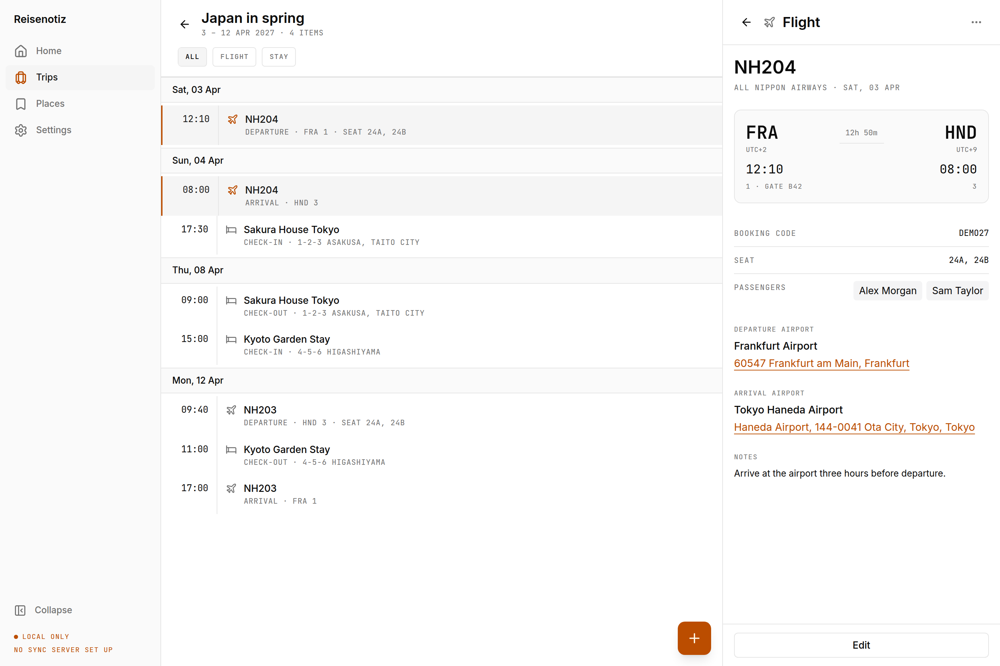
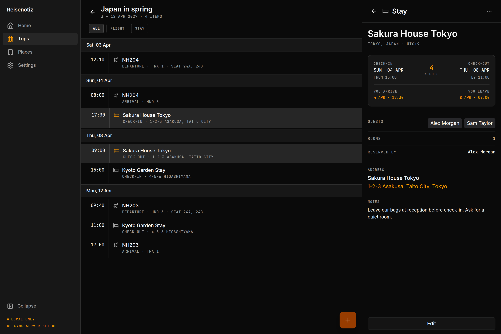
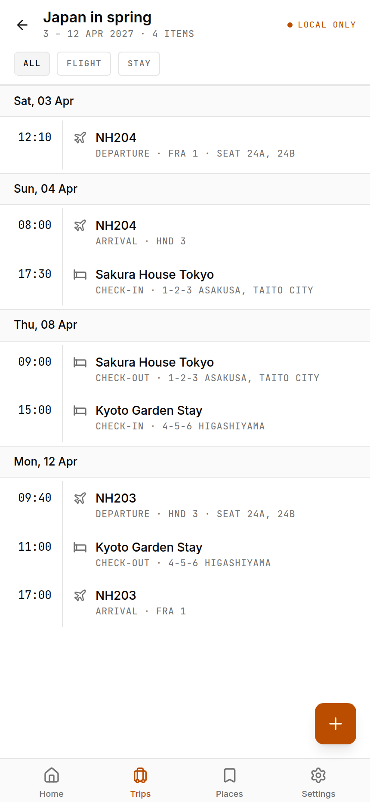
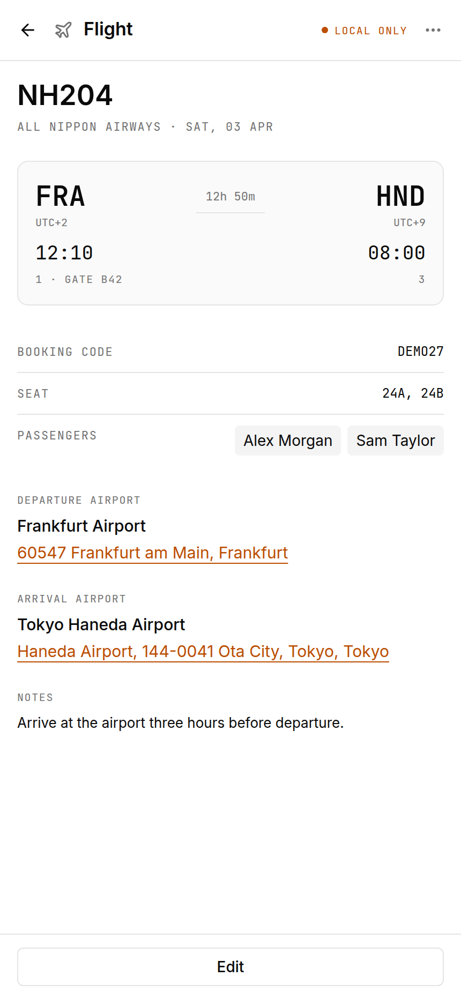
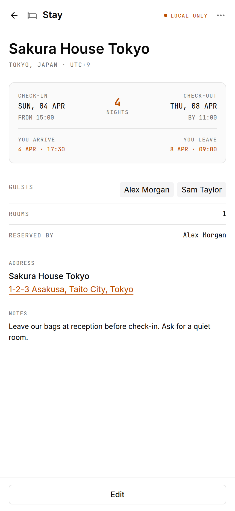

# Reisenotiz

A self-hosted, offline-first travel notes built as a PWA for keeping track of trips, flights, accommodations, and travel documents — all stored locally in your browser.

> **MVP Stage** — This project is in early development. Features are limited, data is stored in browser localStorage only (no backend sync yet), and breaking changes may occur. Use at your own risk and back up any important data.

## Screenshots and video

[Watch the walkthrough](docs/screenshots/walkthrough.mp4) — trip timeline, flight and stay details, saved places, and dark mode. All travel details shown are fictional demo data.

**Desktop**



<details>
<summary>Dark mode</summary>



</details>

**Mobile**

<p>
  
  
  
</p>

## Features

- **Trip Management** — Create and organize trips with timeline views
- **Flight Tracking** — Log flights with airport lookup (IATA codes, timezones)
- **Accommodations** — Track hotels and other lodging with check-in/out details
- **Custom Records** — Save your own airports and accommodation sites for quick reuse
- **Offline-First PWA** — Works without internet, installable on mobile and desktop
- **Dark Mode** — Light and dark theme support
- **Passenger Management** — Track travelers across trip items
- **Attachment Support** — Add notes and attachments to trip items

## Installation

### Docker Compose (example)

```yaml
services:
  app:
    image: ghcr.io/mrmodest/reisenotiz-client:edge-amd64 # change tag to `edge-arm64` for ARM64 builds
    ports:
      - "8080:8080"
    # Uncomment to run with custom UID/GID
    # user: "1000:1000"
    restart: unless-stopped
```

1. Open [http://localhost:8080](http://localhost:8080) in your browser.

### Build from source

Requires Node.js 24+ and pnpm.

```bash
cd apps/frontend
pnpm install
pnpm build
pnpm preview
```

## Roadmap

See [ROADMAP.md](./ROADMAP.md) for planned features and future direction.

## AI Disclamer

- The project is defenetely **NOT** vibe-coded.
- I'm a Software Engineer, and I wrote the majority of the code manually myself.
- I do use AI, but do not trust it more than I would trust a random answer from Stack Overflow
- I won't accept AI's code until it fits my vision of code quality. I feed it with code examples written by myself manually.
- Even by the app UX/UI you can see that AI would generate something less shitty than I did :D

## License

### TLDR:
- PolyForm Noncommercial 1.0.0 (Source-available)
- Free forever for private/non-commercial use.
- Restricted for commercial use.

### Why not fully Open Source?
I want to keep the option open to run a paid hosted version in the future without ending up competing against my own code.

I also don’t like the “open core” model. Splitting the product into free vs paid features always feels messy. If I give something away, I want it to be the full version — not a crippled one.

That’s why I went with PolyForm Noncommercial.
For me it’s a good middle ground:

* free and complete for personal use
* still leaves room to build a business later

Also, this isn’t a library you embed into your own product. It’s a standalone app meant to be used as-is. That’s another reason why this tradeoff feels reasonable to me.

So yeah — it’s not truly open source.
But I think it fits well into the idea of “fair code”.

More on that: [https://fair.io/licenses/](https://fair.io/licenses/)
